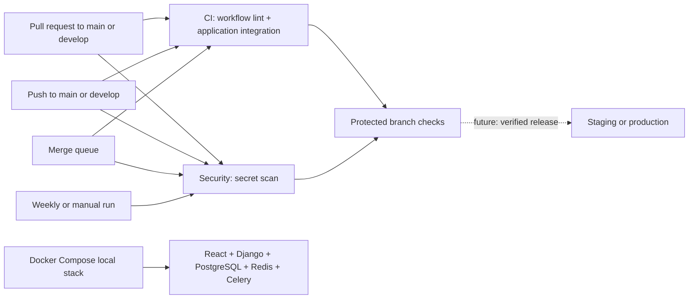

# DevOps guide

## Current state

The repository contains a React/TypeScript frontend, a Django REST backend, PostgreSQL, Redis, Celery worker/Beat services, and a Docker Compose setup for local demonstrations. GitHub Actions checks workflow syntax, runs backend and frontend checks in CI, starts the complete Compose stack, and scans repository history for secrets. No public deployment target or deployment workflow is configured, so a green check does not establish production deployability or the documented two-second performance target.

## Architecture and execution



- **CI / Workflow lint** checks GitHub Actions files with actionlint. The downloaded Linux binary is versioned and checksum verified; checkout is pinned to a commit.
- **CI / Application integration** builds the backend and frontend images, starts PostgreSQL and Redis, runs Django system and migration checks plus the backend suite, runs the frontend suite/lint/production build, then starts the whole Compose stack and requests the frontend health page. It exercises the configured containers but does not benchmark the under-two-second requirement or simulate production load.
- **Security / Secret scan** uses the Gitleaks CLI on push, pull requests, merge queues, weekly, and manual dispatch. It scans the history reachable from the checked-out commit and fails on findings, with secrets redacted from logs. The scanner release is checksum verified. Fork PRs use the ordinary `pull_request` event with read-only token permissions and no deployment credentials. A scheduled run checks the default branch only.
- **Dependabot** proposes weekly updates to GitHub Actions pins. The actionlint and Gitleaks binary versions and SHA-256 checksums must be updated together manually after verifying the upstream release.
- Concurrent runs for the same event and PR or branch are cancelled when a newer run starts. Separate push and PR runs can occur when directly pushing a protected branch that is also the source of a PR; ordinary fork feature branches do not trigger the push workflows.
- GitHub Actions logs and check statuses provide failure visibility. Configure GitHub notification preferences and watch the repository to receive notifications; no external notification integration is configured.

## Branching and protection

Use `main` for production, `develop` for integration, and `feature/*`, `fix/*`, and `hotfix/*` in contributor forks. Open pull requests into `develop` or `main`; promote tested changes to `main` through a PR. These names are a convention, not enforcement by these files.

Repository administrators should:

1. Create `develop` from the appropriate `main` commit and enable GitHub Actions.
2. Create branch rules or rulesets for `main` and `develop`: require pull requests, review as appropriate, and require the **Workflow lint**, **Application integration**, and **Secret scan** status checks. Select the actual check names after the first successful runs. Require branches to be up to date if desired; restrict direct pushes and bypasses according to team policy.
3. Review fork workflow approval settings. Fork PRs do not receive repository secrets. Do not use `pull_request_target` to run untrusted PR code.
4. Enable GitHub's dependency graph, Dependabot alerts, and secret scanning where available for the repository and plan. These settings are not configured by this repository.

Branch protection is configured on GitHub, not enforced by the workflows alone. Check availability of rulesets, required reviews, environments, and scanning features for the repository's visibility and GitHub plan.

## Secrets and environment configuration

No user-provided secrets are currently required. GitHub supplies a token with read-only contents permission for checkout; the Gitleaks CLI does not require an action license or credentials. Fork PRs do not receive repository secrets. Never switch to privileged execution of fork code to make a scan pass.

The local Compose stack reads `DJANGO_SECRET_KEY` and `POSTGRES_PASSWORD` from a private root `.env`; see the README for setup. Do not put those values in GitHub or commit `.env`. GitHub deployment environments, deployment credentials, and a deployment host have not been configured. When a host is selected, store credentials as environment-scoped GitHub Secrets, use separate staging and production identities with least privilege, and document each required variable by its actual name.

## Local verification

Install [actionlint](https://github.com/rhysd/actionlint) and [Gitleaks](https://github.com/gitleaks/gitleaks) from their official releases, then run from the repository root:

```sh
actionlint -color
gitleaks git --redact .
```

The second command scans history reachable from the current checkout; it may differ from the commit checked out in CI. These commands validate workflows and scan secrets; the **Application integration** workflow runs the Django checks, frontend build, and Compose startup check. Gitleaks may identify a candidate secret: rotate/revoke exposed credentials immediately, even if the finding is later removed from the current tree. Inspect findings securely and use narrowly scoped exceptions only after review.

## CI coverage and remaining work

The current `ci.yml` covers the checked-in application commands using PostgreSQL and Redis through Docker Compose. Keep the Python requirements and npm lockfile authoritative when dependencies change. Add measured performance and concurrency evidence against a documented dataset before claiming the two-second target; the current workflow does not establish that result. Dependency vulnerability scanning and language-specific code security analysis are also not configured yet.

## Deployment, health checks and recovery

**Deployment is not configured.** Neither branch deploys, and no production or staging workflow is active. Select the actual host, build artifact, credentials, health endpoint, migration tooling, and release strategy before adding deployment automation. There is no working rollback yet.

To implement it safely:

1. Add staging and production GitHub environments and the host-specific secrets, protection rules, and URLs; configure staging only if a staging target exists. Document names and access requirements.
2. Build an immutable artifact identified by the commit SHA. Gate deployment on successful CI **and** security checks for that exact commit; avoid deploying PR artifacts or stale runs. For manual production deployment, verify the selected SHA passed the same checks and belongs to the approved `main` history. Ensure deployment workflows cannot run untrusted fork code with credentials.
3. Serialize deployments per environment without cancelling an in-progress deployment. Deploy the verified artifact using the host's supported mechanism, record the release identifier and logs, and verify a real health endpoint with a timeout and retries. Fail the job and notify the team if deployment or verification fails. GitHub environment approvals can add a production gate where supported.
4. Define and test a host-specific rollback that restores a retained known-good artifact and verifies its health. Until then, rollback requires an operator to restore a previous known-good release using the host's documented procedure; no command is available in this repository.
5. Before database migrations, take and test backups, assess compatibility with both old and new application versions, and prefer expand/contract migrations. Document recovery and whether a release can safely be rolled back after migration. Never automatically reverse an unknown or destructive migration.

Docker Compose is for local startup and demonstration; it does not publish images or deploy them to a public host. For a hosted deployment, select an immutable image registry and target, then add application-aware release and rollback steps. The current Dockerfiles use multi-stage builds, non-root runtime users, persistent PostgreSQL storage, migration ordering, and service health checks.

## Troubleshooting

- **Workflow lint fails:** run `actionlint -color` locally and fix the reported workflow location. If download or checksum verification fails, check release availability and the pinned checksum against the official release; do not disable verification.
- **Secret scan fails:** a historical finding remains a failure even after removal from the current tree. Inspect the protected Actions logs, rotate any exposed credentials, remove the secret from future use, and consider history cleanup. History rewriting alone does not revoke a credential. Gitleaks may report false positives; review its documented allowlist mechanisms.
- **Required check is missing:** confirm the PR targets `main` or `develop`, Actions are enabled, the workflow exists on the relevant branch, and the ruleset uses the actual job check name. New fork PRs may need maintainer approval.
- **A planned deployment cannot start:** no deployment workflow or target exists yet. Follow the deployment setup above after selecting infrastructure; do not add placeholder credentials or infer a working release from a green baseline check.

## Maintaining pinned tools

Dependabot updates Actions references, not binaries downloaded by shell commands. Periodically check the official [actionlint releases](https://github.com/rhysd/actionlint/releases) and [Gitleaks releases](https://github.com/gitleaks/gitleaks/releases), then update each workflow’s version, URL, and published Linux x64 SHA-256 together in a PR. Run the local checks and review the resulting CI run before merging.
